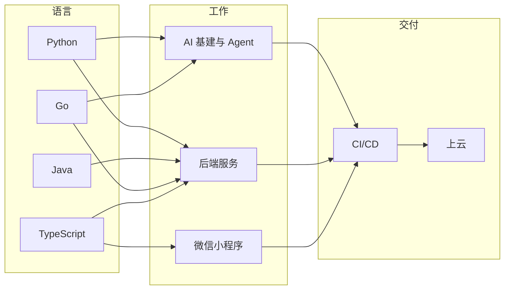

<p align="right"><strong>中文</strong> · <a href="Readme.en.md">English</a></p>

<picture>
  <source media="(prefers-color-scheme: dark)" srcset="assets/banner-dark.svg">
  <source media="(prefers-color-scheme: light)" srcset="assets/banner-light.svg">
  
</picture>

软件工程师，方向是 AI 基建和 Agent 工具。

```console
$ whoami
Wayne

$ ls ~/work
backend/  ai-infra/  agent-tooling/  oss/
```

## 现在

目前在看 AI 基建或后端方向的机会。平时写 Agent 工具，也给开源项目提 PR。

## 技术栈

主要写 Python、Java、Go，客户端用 TypeScript，微信小程序前后端都能做。部署走 CI/CD 上云。


