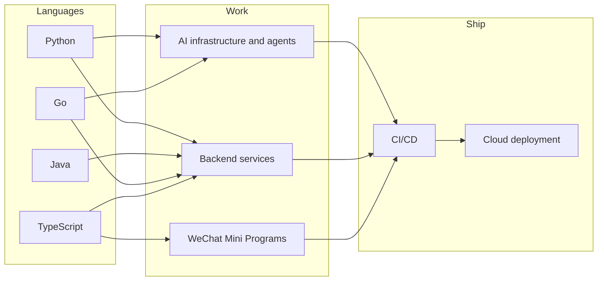

<picture>
  <source media="(prefers-color-scheme: dark)" srcset="assets/banner-dark.svg">
  <source media="(prefers-color-scheme: light)" srcset="assets/banner-light.svg">
  
</picture>

Software engineer working on AI infrastructure and agent tooling.

```console
$ whoami
Wayne

$ ls ~/work
backend/  ai-infra/  agent-tooling/  oss/
```

## Now

Looking for a role in AI infrastructure or backend engineering. In the meantime, I'm building agent tooling and contributing to open source.

## Stack

I work mostly in Python, Java, and Go, and use TypeScript for full-stack WeChat Mini Program development. Deployment goes through CI/CD to the cloud.


