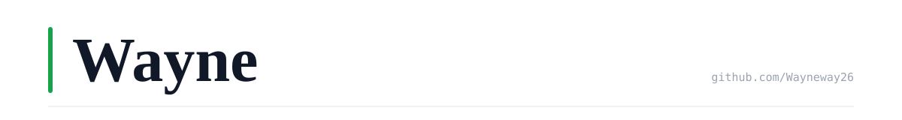
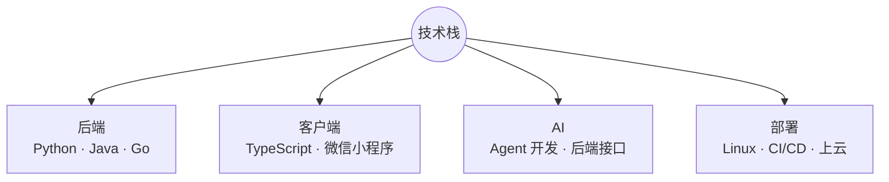
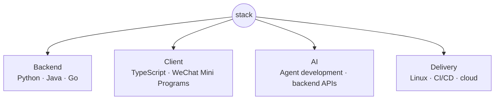

<p align="right"><strong>中文</strong> · <a href="#english">English</a></p>

<picture>
  <source media="(prefers-color-scheme: dark)" srcset="assets/banner-dark.svg">
  <source media="(prefers-color-scheme: light)" srcset="assets/banner-light.svg">
  
</picture>

软件工程师，方向为 AI Agent 开发和 AI 相关后端接口开发，同时具备自动化测试、Agent 机器人开发

```console
$ whoami
Wayne

$ ls ~/work
backend/  agent-tooling/  ai-apis/  oss/
```

## 现在

目前秋招求职中，主要在看AI Agent 开发、后端开发、测试开发的机会。

## 技术栈

主要写 Python、Java、Go，客户端用 TypeScript，有全栈开发并部署云端，包含域名、安全组规则配置经验，微信小程序前后端都能做。Linux 日常在用，CI/CD 和上云部署也能自己搞定。



---

<p align="right"><a href="#top">中文</a> · <strong>English</strong></p>

## English

Software engineer working on AI agent development and AI-related backend APIs.

```console
$ whoami
Wayne

$ ls ~/work
backend/  agent-tooling/  ai-apis/  oss/
```

### Now

Currently job hunting during the autumn recruitment cycle, looking for backend, test development, or AI agent roles.

### Stack

I mostly write Python, Java, and Go. On the client side I use TypeScript, including full-stack WeChat Mini Programs. I also work with Linux, CI/CD, and cloud deployment.


