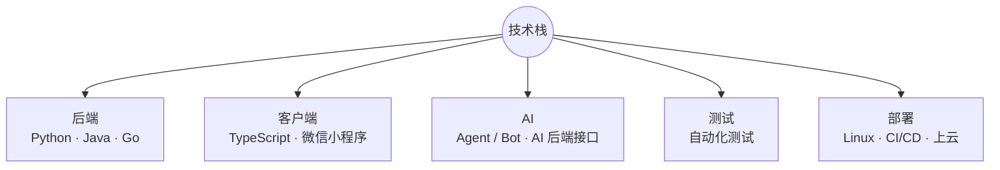
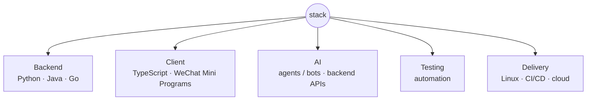

<p align="right"><strong>中文</strong> · <a href="#english">English</a></p>

<picture>
  <source media="(prefers-color-scheme: dark)" srcset="assets/banner-dark.svg">
  <source media="(prefers-color-scheme: light)" srcset="assets/banner-light.svg">
  
</picture>

软件工程师，方向是 AI Agent、AI 后端接口和 Agent Bot 开发，也写自动化测试。

```console
$ whoami
Wayne

$ ls ~/work
backend/  agent-tooling/  ai-apis/  testing/  oss/
```

## 现在

目前秋招中，主要看 AI Agent、后端开发和测试开发的机会。

## 技术栈

主要写 Python、Java、Go，客户端用 TypeScript，微信小程序前后端都能做。做过全栈开发和云端部署，域名、安全组规则这些也配过；Linux 日常在用，CI/CD 和上云部署也能自己搞定。



---

<p align="right"><a href="#top">中文</a> · <strong>English</strong></p>

## English

Software engineer working on AI agents, agent bots, and AI-related backend APIs. I also write automated tests.

```console
$ whoami
Wayne

$ ls ~/work
backend/  agent-tooling/  ai-apis/  testing/  oss/
```

### Now

Currently in the autumn recruitment cycle, looking for AI agent, backend, or test development roles.

### Stack

I mostly write Python, Java, and Go, and use TypeScript to build WeChat Mini Programs on both the client and server. I've also built and deployed full-stack projects to the cloud, including domain and security group configuration. Linux and CI/CD are part of my daily workflow, and I can handle the deployment end to end.


